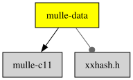

# mulle-data

#### #️⃣  A collection of hash functions

* bit avalance for integers and pointers
* FNV1A for hashing strings for hashtables
* farmhash for (large) data

It contains the convenient `struct mulle_data` to keep `bytes` and
`length` together and to pass it around.

And it contains `struct mulle_range`, which represents ranges of data with
a location (offset) and a length.


| Release Version                                       | Release Notes  | AI Documentation
|-------------------------------------------------------|----------------|---------------
|  [](//github.com/mulle-c/mulle-data/actions)  | [RELEASENOTES](RELEASENOTES.md) | [DeepWiki for mulle-data](https://deepwiki.com/mulle-c/mulle-data)


## API

| Documentation                     | Description
|-----------------------------------|-------------------
| [mulle-data](dox/API_DATA.md)     | `struct mulle_data` holds a pointer to a block of memory (`void *bytes`) and its length in bytes (`size_t length`).
| [mulle-fnv1a](dox/API_FNV1A.md)   | FNV-1a  is a fast, non-cryptographic hash that provides good distribution and low collisions for strings
| [mulle-hash](dox/API_HASH.md)     | MurmurHash3 and FarmHash for fast, efficient, and high-quality hashes of arbitraty data
| [mulle-prime](dox/API_PRIME.md)   | Prime number support for hashtables
| [mulle-range](dox/API_RANGE.md)   | `struct mulle_range` defines a range with a location and length


## Documentation & Guides

* [API Summary](asset/dox/api/toc)


### You are here




## Add

### Add mulle-data via mulle-core

mulle-data is a component of the
[mulle-core](//github.com/mulle-core/mulle-core) library.
In your code include its umbrella header:

``` c
#include <mulle-core/mulle-core.h>
```

In your project add mulle-core as a git submodule and link against it:

``` bash
git submodule add -f "https://github.com/mulle-core/mulle-core.git" \
                     "stash/mulle-core"
git submodule update --init --recursive
```

then add these comands to your `CMakeLists.txt`:

``` cmake
include_directories( SYSTEM "stash/mulle-core/src")
add_subdirectory( stash/mulle-core)
target_link_libraries( ${PROJECT_NAME} PUBLIC mulle-core)
```

Or let [mulle-sde](//github.com/mulle-sde) do it:

``` sh
mulle-sde add mulle-core/mulle-core
```


### Add mulle-data as a cmake subproject

In your code include its header:

``` c
#include <mulle-data/mulle-data.h>
```

Add mulle-data and dependencies as git submodules and link against
them:

``` bash
git submodule add -f --name "mulle-c11" \
                            "https://github.com/mulle-c/mulle-c11.git" \
                            "stash/mulle-c11"
git submodule add -f --name "src/xxhash/xxhash.h" \
                            "https://raw.githubusercontent.com/mulle-c/xxHash/refs/heads/dev/xxhash.h" \
                            "stash/src/xxhash/xxhash.h"
git submodule add -f --name "mulle-data" \
                        "https://github.com/mulle-c/mulle-data" \
                        "stash/mulle-data"
git submodule update --init --recursive
```

``` cmake
include_directories( SYSTEM "${CMAKE_BINARY_DIR}/include")

add_subdirectory( stash/mulle-c11)
add_subdirectory( stash/src/xxhash/xxhash.h)
add_subdirectory( stash/mulle-data)

target_link_libraries( ${PROJECT_NAME} PUBLIC mulle-c11)
target_link_libraries( ${PROJECT_NAME} PUBLIC src/xxhash/xxhash.h)
target_link_libraries( ${PROJECT_NAME} PUBLIC mulle-data)
```

Or let [mulle-sde](//github.com/mulle-sde) do it:

``` sh
mulle-sde add github:mulle-c/mulle-data
```

## Individual Install

Install all the prerequisites.

``` bash
PREFIX=/tmp/usr/local
BUILD_DIR="mulle-data/build"

cmake -S "mulle-data" -B "${BUILD_DIR}"    \
  -DCMAKE_BUILD_TYPE="Release"                  \
  -DCMAKE_INSTALL_PREFIX="${PREFIX}"            \
  -DCMAKE_PREFIX_PATH="${PREFIX}"               \
  -DCMAKE_C_FLAGS="-I"${PREFIX}"/include"       \
&& cmake --build "${BUILD_DIR}" &&              \
&& cmake --install "${BUILD_DIR}"
```


## Author

[Nat!](https://mulle-kybernetik.com/weblog) for Mulle kybernetiK  


